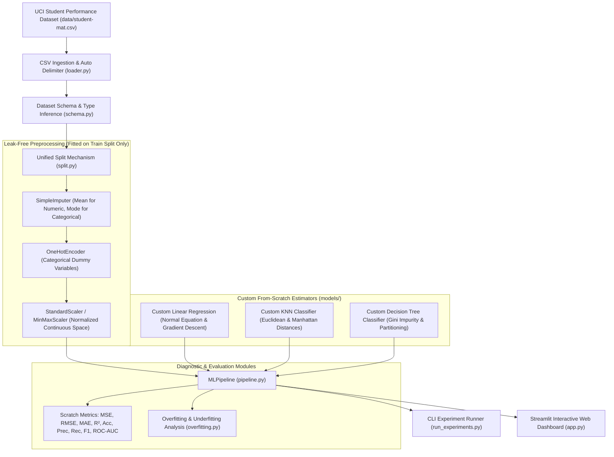

# EduPredict: A Classical Machine Learning Framework Implemented From Scratch

[](https://www.python.org/downloads/)
[-success.svg)]()
[]()

> **EduPredict** is an educational Classical Machine Learning framework designed for predicting student academic performance (continuous score regression) and early academic risk detection (binary classification). 
> 
> The core architectural principle of EduPredict is genuine first-principles implementation: **all mathematical operations, linear algebra routines, descriptive statistics, missing value imputation, categorical encoding, feature scaling, analytical loss functions, optimization algorithms, data splitting, evaluation metrics, and the core Machine Learning models (Linear Regression, KNN Classifier, Decision Tree Classifier) are implemented entirely from first principles using standard Python**.
> 
> EduPredict contains **ZERO** dependencies on third-party ML/data libraries: No NumPy, No Pandas, No Scikit-learn, No SciPy, No TensorFlow, and No PyTorch. Core ML implementations also eliminate reliance on the standard library `math` and `statistics` modules, calculating all square roots, exponents, logarithms, means, and variances explicitly from foundational definitions.

---

## Table of Contents
1. [Project Overview & Architectural Design](#1-project-overview--architectural-design)
2. [Strict Zero-Dependency Policy](#2-strict-zero-dependency-policy)
3. [System Architecture](#3-system-architecture)
4. [Dataset & Problem Formulation](#4-dataset--problem-formulation)
5. [Custom Machine Learning Models Implemented From Scratch](#5-custom-machine-learning-models-implemented-from-scratch)
   - [Custom Linear Regression (Normal Equation & Gradient Descent)](#51-custom-linear-regression)
   - [Custom K-Nearest Neighbors Classifier](#52-custom-k-nearest-neighbors-classifier)
   - [Custom Decision Tree Classifier](#53-custom-decision-tree-classifier)
6. [Mathematical Foundations & Linear Algebra Implemented From Scratch](#6-mathematical-foundations--linear-algebra-implemented-from-scratch)
7. [Data Preprocessing & Data Leakage Prevention](#7-data-preprocessing--data-leakage-prevention)
8. [Overfitting & Underfitting Analysis](#8-overfitting--underfitting-analysis)
9. [Evaluation Metrics Implemented From Scratch](#9-evaluation-metrics-implemented-from-scratch)
10. [Unified MLPipeline & Experiment Suite](#10-unified-mlpipeline--experiment-suite)
11. [Interactive Streamlit Web Dashboard](#11-interactive-streamlit-web-dashboard)
12. [Empirical Benchmark Results](#12-empirical-benchmark-results)
13. [Setup & Execution Instructions](#13-setup--execution-instructions)
14. [Testing & Verification](#14-testing--verification)

---

## 1. Project Overview & Architectural Design

In modern machine learning education, pipelines are often treated as black boxes, calling high-level libraries without grasping numerical stability, gradient derivations, matrix conditioning, data leakage traps, or decision boundary geometry.

EduPredict addresses this by implementing the entire ML stack from the ground up:
- **Two Authoritative Academic Objectives:**
  1. **Academic Performance Regression:** Predict continuous student final mathematics grade ($G3 \in [0, 20]$) on the UCI Student Performance Mathematics dataset.
  2. **Academic Risk Early Warning:** Classify students into **Normal Trajectory ($0$)** vs. **At-Risk ($1$)** ($G3 < 10$ passing threshold in the Portuguese secondary educational system).
- **Leakage Prevention Guarantees:** Intermediate examination grades ($G1$ and $G2$) are strictly excluded from all training feature matrices to eliminate trivial target leakage and ensure meaningful predictive learning.
- **Generic Tabular Capabilities:** While pre-configured for educational analytics, the framework dynamically infers schemas, detects numerical and categorical features, handles missing values, and trains models on arbitrary tabular datasets.

---

## 2. Strict Zero-Dependency Policy

EduPredict enforces a strict architectural boundary verified by automated Abstract Syntax Tree (AST) scanning (`tests/test_dependency_compliance.py`):

| Component Area | Implementation Tooling | Prohibited Libraries |
| :--- | :--- | :--- |
| **Machine Learning Estimators** | **Custom From Scratch** (`LinearRegression`, `KNNClassifier`, `DecisionTreeClassifier`) | Scikit-learn, PyTorch, TensorFlow |
| **Linear Algebra & Vector Math** | **Custom Scratch Engine** (`edupredict.math.matrices`, `vectors`) | NumPy, SciPy, standard `math` |
| **Descriptive Statistics** | **Custom Scratch Engine** (`edupredict.math.stats`) | NumPy, SciPy, Pandas, standard `statistics` |
| **Data Ingestion & Parsing** | **Pure Python Standard Library** (`csv` with auto-delimiter detection) | Pandas |
| **Preprocessing & Transformers** | **Custom From Scratch** (`SimpleImputer`, `OneHotEncoder`, `StandardScaler`, `MinMaxScaler`) | Scikit-learn preprocessing |
| **Data Splitting & Cross-Validation**| **Custom From Scratch** (`train_test_split`, `KFold`, `StratifiedKFold`) | Scikit-learn model_selection |
| **Loss Functions & Gradients** | **Custom From Scratch** (MSE, MAE, analytical MSE gradient) | PyTorch, TensorFlow, SciPy |
| **Optimization** | **Custom From Scratch** (Batch/Mini-batch Gradient Descent, Polyak Momentum, Early Stopping) | Scikit-learn optimizers, PyTorch |
| **Evaluation Metrics** | **Custom From Scratch** (Accuracy, Precision, Recall, F1, Confusion Matrix, ROC-AUC, MSE, RMSE, MAE, R²) | Scikit-learn metrics |
| **Presentation & UI** | **Streamlit & Matplotlib** (rendering only) | Seaborn, Plotly |

---

## 3. System Architecture



---

## 4. Dataset & Problem Formulation

### 4.1 Primary Dataset: UCI Student Performance (Mathematics)
- **Source:** P. Cortez and A. Silva, *Using Data Mining to Predict Secondary School Student Performance*, 2008.
- **Location:** `data/student-mat.csv` (395 records, 33 semicolon-separated columns).
- **Student Profile Attributes:** Demographic factors (`school`, `sex`, `age`, `address`, `famsize`, `Pstatus`), parental background (`Medu`, `Fedu`, `Mjob`, `Fjob`), study habits (`studytime`, `failures`, `schoolsup`, `famsup`, `paid`), social lifestyle (`activities`, `romantic`, `famrel`, `freetime`, `goout`, `Dalc`, `Walc`, `health`, `absences`), and grade records (`G1`, `G2`, `G3`).

### 4.2 Problem Formulation & Leakage Safeguards
1. **Task 1: Continuous Final Grade Regression (`G3`)**
   - **Target:** `G3` ($\in [0, 20]$).
   - **Leakage Prevention:** Intermediate evaluation grades `G1` (first period) and `G2` (second period) are **strictly excluded** from the input feature space. In real academic applications, the model must predict outcomes early in the semester before intermediate exams occur.
2. **Task 2: Academic Risk Detection (`academic_risk`)**
   - **Target:** Binary risk indicator:
     $$\text{academic\_risk} = \begin{cases} 1 & \text{if } G3 < 10 \text{ (Failing / At-Risk)} \\ 0 & \text{if } G3 \ge 10 \text{ (Passing / Normal)} \end{cases}$$
   - **Leakage Prevention:** Features `G1`, `G2`, and `G3` are **strictly excluded** from classification inputs.

---

## 5. Custom Machine Learning Models Implemented From Scratch

### 5.1 Custom Linear Regression (`edupredict.models.LinearRegression`)
- **Dual Solvers:**
  1. **Closed-Form Normal Equation:**
     $$\mathbf{w} = (\mathbf{X}^T \mathbf{X} + \lambda \mathbf{I})^{-1} \mathbf{X}^T \mathbf{y}$$
     Solved using our Gauss-Jordan elimination engine with partial row pivoting. Features $L_2$ Tikhonov regularization ($\lambda$) preventing matrix singularity from collinear one-hot columns.
  2. **Iterative Gradient Descent:**
     Optimizes Mean Squared Error with analytical gradients:
     $$\nabla_{\mathbf{w}} J = \frac{2}{M} \mathbf{X}^T (\mathbf{X}\mathbf{w} + b - \mathbf{y}) + 2\lambda\mathbf{w}, \quad \nabla_b J = \frac{2}{M} \sum_{i=1}^M (\hat{y}_i - y_i)$$
     Supports full-batch and mini-batch sampling, Polyak momentum, and early stopping.
- **Attributes:** `coef_`, `intercept_`, `loss_history_`, `n_iter_`.

### 5.2 Custom K-Nearest Neighbors Classifier (`edupredict.models.KNNClassifier`)
- **Distance Metrics:**
  - Euclidean ($L_2$ norm): $d(u, v) = \sqrt{\sum_{i=1}^n (u_i - v_i)^2}$
  - Manhattan ($L_1$ norm): $d(u, v) = \sum_{i=1}^n |u_i - v_i|$
- **Weighting Schemes:**
  - Uniform voting: each neighbor receives 1 vote.
  - Distance-weighted voting: $w_i = \frac{1}{d(x, x_i) + \epsilon}$.
- **Deterministic Tie-Breaking:** Resolves exact distance/vote ties deterministically using predefined class order.
- **Class Probabilities:** Computes normalized vote shares across classes via `predict_proba`.

### 5.3 Custom Decision Tree Classifier (`edupredict.models.DecisionTreeClassifier`)
- **Impurity Criterion:** Gini Impurity:
  $$Gini(S) = 1 - \sum_{k=1}^C p_k^2$$
- **Split Optimization:** Evaluates candidate split midpoints between sorted unique feature values, maximizing Gini Gain:
  $$\Delta Gini = Gini(S) - \left( \frac{|S_L|}{|S|} Gini(S_L) + \frac{|S_R|}{|S|} Gini(S_R) \right)$$
- **Pruning & Stopping Criteria:** Configurable `max_depth`, `min_samples_split`, `min_samples_leaf`, and purity thresholds.
- **Feature Importance:** Computes normalized total weighted impurity reduction attributed to each feature across all tree nodes.

---

## 6. Mathematical Foundations & Linear Algebra Implemented From Scratch

All mathematical functions are implemented without `numpy`, `scipy`, `math`, or `statistics`:

- **Vectors (`edupredict/math/vectors.py`):** Vector addition, subtraction, dot product, vector $L_2$ norm, Euclidean distance (`(sum(...) ) ** 0.5`), and Manhattan distance.
- **Matrices (`edupredict/math/matrices.py`):** Transpose, matrix-matrix multiplication ($O(mnp)$), matrix-vector multiplication, element-wise addition, scalar multiplication, identity matrix creation, and Gauss-Jordan elimination with partial pivoting for matrix inversion ($O(n^3)$).
- **Statistics (`edupredict/math/stats.py`):** Arithmetic mean, median, mode, sample variance, standard deviation, sample covariance, Pearson correlation coefficient, and pairwise correlation matrices.
- **Numerical Exponent & Logarithm (`edupredict/math/activations.py`):** Range-reduced Taylor series expansion for $e^x$ with repeated squaring, and natural logarithm $\ln(x)$ using argument reduction and series expansion, achieving $< 10^{-10}$ relative error.

---

## 7. Data Preprocessing & Data Leakage Prevention

EduPredict eliminates data leakage by design:
1. **Isolated Data Splitting:** The raw feature matrix $\mathbf{X}$ and target $\mathbf{y}$ are partitioned into train and holdout test sets **prior** to any data transformation.
2. **Train-Only Parameter Estimation:**
   - `SimpleImputer`: Computes mean (numeric) and mode (categorical) strictly on training records.
   - `OneHotEncoder`: Learns category alphabets solely from the training partition; gracefully maps unseen test categories to all-zero vectors.
   - `StandardScaler`: Calculates $\mu$ and $\sigma$ only on training rows; transforms both partitions as $z = \frac{x - \mu}{\sigma}$.
3. **Frozen Evaluation:** Preprocessors apply their frozen training parameters to test data without recalculation.

---

## 8. Overfitting & Underfitting Analysis

EduPredict provides dedicated diagnostic tools (`edupredict/analysis/overfitting.py`) to systematically demonstrate the Bias-Variance tradeoff:

```
Underfitting (High Bias)  <--------  Optimal Balance  -------->  Overfitting (High Variance)
- Low model capacity                 - Peak validation score    - Memorizes training noise
- Low train & test accuracy          - Generalizes well         - High train / Low test score
```

1. **KNN Neighborhood Size ($k$):**
   - $k = 1$: Overfitting regime. Training accuracy is 100%, but holdout validation accuracy is lower due to high sensitivity to individual noise points.
   - Optimal $k$ ($k \approx 15$ on UCI Mathematics): Smooths local variance, achieving peak holdout accuracy (~68.4%).
   - Large $k$: Underfitting regime. Over-smoothes decision boundaries, defaulting to majority class proportions.
2. **Decision Tree Depth (`max_depth`):**
   - Depth = 1 (Decision Stump): Underfitting regime. Cannot model multi-feature interactions.
   - Depth = 3–5: Balanced regime capturing dominant split rules (e.g., student failures, past school support).
   - Deep Depth (10+): Overfitting regime. Partitions single outliers into pure leaves, causing test accuracy to degrade.
3. **Linear Regression L2 Penalty ($\lambda$):**
   - $\lambda \approx 0$: High variance, vulnerable to collinear one-hot columns.
   - Optimal $\lambda$: Constrains coefficient magnitudes, stabilizing predictive generalization.

---

## 9. Evaluation Metrics Implemented From Scratch

- **Regression Metrics (`edupredict/metrics/regression.py`):**
  - Mean Squared Error: $\text{MSE} = \frac{1}{N} \sum_{i=1}^N (y_i - \hat{y}_i)^2$
  - Root Mean Squared Error: $\text{RMSE} = \sqrt{\text{MSE}}$
  - Mean Absolute Error: $\text{MAE} = \frac{1}{N} \sum_{i=1}^N |y_i - \hat{y}_i|$
  - Coefficient of Determination: $R^2 = 1 - \frac{\sum (y_i - \hat{y}_i)^2}{\sum (y_i - \bar{y})^2}$
- **Classification Metrics (`edupredict/metrics/classification.py`):**
  - Accuracy: $\frac{\text{TP} + \text{TN}}{\text{TP} + \text{TN} + \text{FP} + \text{FN}}$
  - Precision: $\frac{\text{TP}}{\text{TP} + \text{FP}}$
  - Recall: $\frac{\text{TP}}{\text{TP} + \text{FN}}$
  - F1 Score: $\frac{2 \cdot \text{Precision} \cdot \text{Recall}}{\text{Precision} + \text{Recall}}$
  - Confusion Matrix: $2 \times 2$ contingency table.
  - ROC Curve & Numerical Trapezoidal AUC: Computes TPR and FPR across unique thresholds and calculates area via the trapezoidal rule.

---

## 10. Unified MLPipeline & Experiment Suite

The `MLPipeline` orchestrates leak-free training, hyperparameter validation, and inference:
- **`fit(raw_X, y, test_size=0.2)`**: Executes train/test split, fits transformers on training data only, trains the selected custom model, and computes evaluation metrics.
- **`predict_single(record_dict)`**: Performs end-to-end inference for a single student profile provided as a dictionary.
- **`predict_single_proba(record_dict)`**: Returns class probability distributions for classification models.

---

## 11. Interactive Streamlit Web Dashboard

The web interface (`app.py`) provides an interactive educational exploration environment:
- **Dataset Overview & Validation:** Tabular data preview, missing value audits, and correlation heatmaps.
- **Regression Studio:** Interactive training of Custom Linear Regression with Normal Equation and Gradient Descent toggles, live loss curve visualization, and single-student final grade predictions.
- **Classification Studio:** Custom KNN and Decision Tree configuration, confusion matrices, ROC curve rendering, and single-student academic risk assessment.
- **Overfitting & Underfitting Explorer:** Interactive tabs displaying training vs. validation complexity curves for KNN ($k$), Decision Tree (`max_depth`), and Linear Regression ($\lambda$).
- **Benchmark Suite:** Side-by-side performance comparison charts.
- **Architecture & Methods:** Documentation of mathematical derivations and zero-dependency compliance.

---

## 12. Empirical Benchmark Results

Empirical results computed on the primary UCI Mathematics dataset (`data/student-mat.csv`, holdout test size 20%, random seed 42):

### 12.1 Regression Task: Final Mathematics Grade ($G3$)
*(Leakage safeguard: $G1$ and $G2$ excluded)*

| Model | Solver / Hyperparameters | MSE | RMSE | MAE | $R^2$ | Train Time |
| :--- | :--- | :---: | :---: | :---: | :---: | :---: |
| **Custom Linear Regression (Selected)** | Gradient Descent ($\lambda=5.0$) | **15.53** | **3.94** | **2.90** | **+0.060** | ~4 ms |
| **Custom Linear Regression (Selected)** | Normal Equation ($\lambda=5.0$) | **15.53** | **3.94** | **2.90** | **+0.060** | ~2 ms |
| Custom Linear Regression (Unregularized) | Gradient Descent ($\lambda=0.0$) | 18.16 | 4.26 | 3.25 | -0.099 | ~6 ms |
| *Training-Mean Baseline* | Predicts $\bar{y}_{\text{train}} = 10.4082$ | 16.53 | 4.07 | 3.00 | -0.0001 | 0 ms |

### 12.2 Classification Task: Academic Risk ($G3 < 10$)
*(Leakage safeguard: $G1$, $G2$, and $G3$ excluded)*

| Model | Configuration | Accuracy | Precision | Recall | F1 Score | ROC-AUC | Infer Time |
| :--- | :--- | :---: | :---: | :---: | :---: | :---: | :---: |
| **Custom Decision Tree (Selected)** | `max_depth = 2`, $\tau = 0.50$ | **69.62%** | **0.5500** | **0.4231** | **0.4783** | **0.6161** | ~14 ms |
| **Custom KNN Classifier** | $k = 5$, uniform, $\tau = 0.50$ | 64.56% | 0.4167 | 0.1923 | 0.2632 | 0.5653 | ~7 ms |
| *Majority-Class Baseline* | Predicts class 0 (Normal) | 67.09% | 0.0000 | 0.0000 | 0.0000 | 0.5000 | 0 ms |

### 12.3 Overfitting Diagnostic Summary (Internal Validation Protocol)
To ensure complete independence between hyperparameter selection and final testing, the 316-sample development pool is split into Train-Sub (253 samples) and Validation (63 samples). The 79-sample holdout test set remains strictly isolated:
- **Decision Tree Complexity & Pruning:** Unconstrained trees (`max_depth = 5`) overfit the 40 one-hot dimensions, dropping validation accuracy to 58.73% and test ROC-AUC to 0.4989. Pruning to `max_depth = 2` achieves **69.84% validation accuracy** and boosts holdout test accuracy to **69.62%** and ROC-AUC to **0.6161**.
- **Linear Regression Regularization:** Unregularized OLS ($\lambda=0$) overfits sample variance ($R^2 = -0.0992$). Selecting $\lambda^* = 5.0$ on validation ($R^2 = +0.0431$) translates into out-of-sample holdout improvement ($R^2 = +0.0600$, RMSE = 3.94), successfully outperforming the training-mean baseline.
- **KNN Complexity Curve:** Peak validation accuracy reaches **66.67%** at $k = 19$, while $k = 5$ maintains the strongest discriminant ranking (ROC-AUC = 0.5653).

### 12.4 Academic Baselines & Confusion Matrix Verification
- **Holdout Test Set ($N=79$):** 53 Normal (67.09%), 26 At-Risk (32.91%).
- **Decision Tree Confusion Matrix (`depth=2`):** $\text{TN} = 44$, $\text{FP} = 9$, $\text{FN} = 15$, $\text{TP} = 11$ (identifies 11 of 26 at-risk students; Precision = 55.0%, Recall = 42.3%).
- **KNN Confusion Matrix ($k=5$):** $\text{TN} = 46$, $\text{FP} = 7$, $\text{FN} = 21$, $\text{TP} = 5$ (identifies 5 of 26 at-risk students; Precision = 41.7%, Recall = 19.2%).
- **Majority-Class Baseline:** $\text{TN} = 53$, $\text{FP} = 0$, $\text{FN} = 26$, $\text{TP} = 0$ (fails to identify any at-risk student).

---

## 13. Setup & Execution Instructions

### 13.1 Environment Prerequisites
- Python 3.10 or higher.
- Optional presentation dependencies: `streamlit` (UI) and `matplotlib` (rendering).
- Standard Python standard library only for core operations.

```bash
# Clone the repository
git clone https://github.com/Jenish045/EduPredict.git
cd EduPredict

# Install optional UI dependencies
pip install streamlit matplotlib
```

### 13.2 Running the Command-Line Experiment Runner
```bash
# Run complete experiment suite on the primary UCI dataset
python run_experiments.py

# Run on synthetic dataset with custom seed
python run_experiments.py --data data/student_performance.csv --seed 42
```

### 13.3 Launching the Interactive Web Application
```bash
streamlit run app.py
```

---

## 14. Testing & Verification

EduPredict includes a comprehensive automated test suite (110 unit and integration tests passing with 100% success rate) executed via Python's standard `unittest` framework:

```bash
# Run the complete test suite
python -m unittest discover tests

# Run specific test modules
python -m unittest tests/test_models.py
python -m unittest tests/test_dependency_compliance.py
python -m unittest tests/test_math_matrices.py
python -m unittest tests/test_pipeline.py
```

### Test Coverage Highlights
- **`test_dependency_compliance.py`:** AST verification ensuring ZERO imports of NumPy, Pandas, Scikit-learn, SciPy, Torch, TensorFlow, or standard library `math`/`statistics` in `edupredict/`.
- **`test_models.py`:** Unit tests for Custom Linear Regression (Normal Equation & Gradient Descent), Custom KNN, and Custom Decision Tree.
- **`test_serialization.py`:** Round-trip persistence tests verifying model state recovery via JSON and Pickle.
- **`test_pipeline.py` & `test_pipeline_integrity.py`:** Strict verification of zero data leakage across training and test splits.
- **`test_app_logic.py`:** Programmatic verification of all dashboard data flows, pipeline fitting, and single-student inference paths without requiring GUI browser execution.
