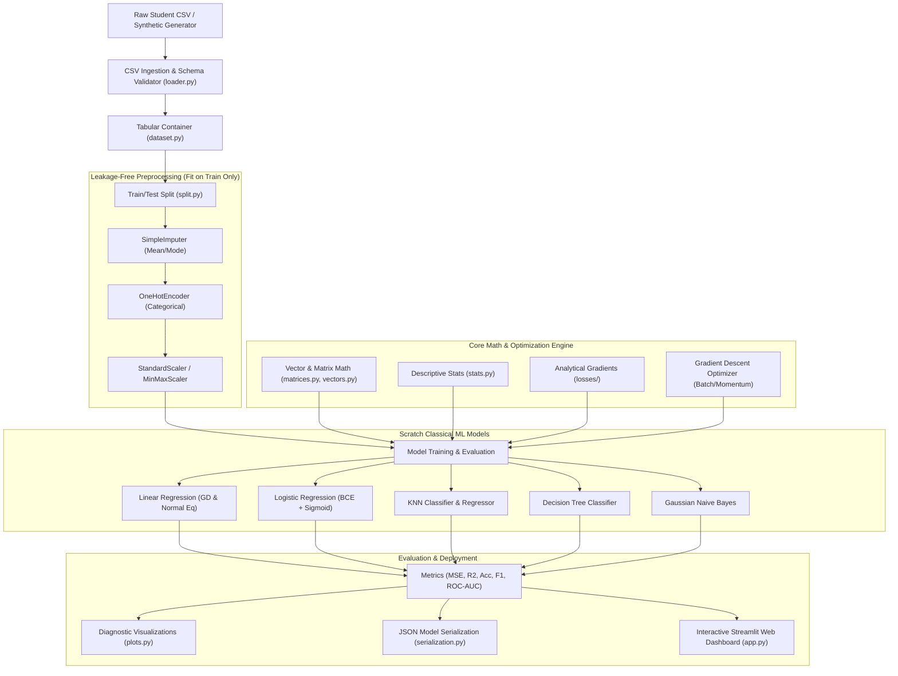

# EduPredict: A Classical Machine Learning Framework Implemented From Scratch

[](https://www.python.org/downloads/)
[]()
[]()
[]()

> **EduPredict** is an end-to-end Classical Machine Learning framework designed for predicting student academic performance (continuous score regression) and early academic risk detection (binary classification). The core distinguishing feature is that **every mathematical operation, linear algebra routine, data transformer, statistical formula, optimization algorithm, model architecture, loss function, and evaluation metric is implemented 100% from first principles using standard Python** — without relying on NumPy, Pandas, Scikit-Learn, SciPy, PyTorch, or TensorFlow.

---

## Table of Contents
1. [Project Overview & Objectives](#1-project-overview--objectives)
2. [Strict Dependency Policy & Compliance](#2-strict-dependency-policy--compliance)
3. [System Architecture](#3-system-architecture)
4. [Dataset & Problem Formulation](#4-dataset--problem-formulation)
5. [Mathematical Foundations & Linear Algebra](#5-mathematical-foundations--linear-algebra)
6. [Data Preprocessing & Leakage Prevention](#6-data-preprocessing--leakage-prevention)
7. [Objective Functions, Loss Gradients & Optimization](#7-objective-functions-loss-gradients--optimization)
8. [Classical ML Algorithms Implemented From Scratch](#8-classical-ml-algorithms-implemented-from-scratch)
9. [Evaluation Metrics & ROC Analysis](#9-evaluation-metrics--roc-analysis)
10. [Model Persistence & JSON Serialization](#10-model-persistence--json-serialization)
11. [Multiclass One-vs-Rest Extension](#11-multiclass-one-vs-rest-extension)
12. [Interactive Streamlit Web Dashboard](#12-interactive-streamlit-web-dashboard)
13. [Empirical Benchmark Results](#13-empirical-benchmark-results)
14. [Diagnostic Visualizations](#14-diagnostic-visualizations)
15. [Setup & Execution Instructions](#15-setup--execution-instructions)
16. [Comprehensive Viva Voce Guide](#16-comprehensive-viva-voce-guide)
17. [Limitations & Future Scope](#17-limitations--future-scope)

---

## 1. Project Overview & Objectives

In modern machine learning education, students frequently call high-level API methods such as `model.fit()` and `model.predict()` without understanding numerical stability, gradient derivations, matrix conditioning, data leakage traps, or decision boundary geometry. 

**EduPredict** was engineered as a 30-mark college Machine Learning Lab project to address this gap. It solves two critical educational tasks:
1. **Academic Performance Regression:** Predict continuous student final examination scores ($[0.0, 100.0]$) given study hours, prior term scores, class attendance, and assignment completion.
2. **Academic Risk Early Warning:** Classify students into **Normal / Good Standing ($0$)** vs. **At-Risk ($1$)** ($< 60.0\%$ threshold) to enable timely academic mentoring and targeted tutoring.

### Why Implementation From Scratch Matters
- **Transparent Mathematics:** Demystifies "black-box" solvers by exposing analytical loss gradients, Gaussian-Jordan elimination with row pivoting, recursive tree entropy partitioning, and trapezoidal numerical integration.
- **Scientific Integrity:** Demonstrates rigorous data leakage prevention by isolating transformation statistics ($\mu, \sigma, \min, \max$, category vocabularies) strictly to the training fold.
- **Deep Algorithmic Mastery:** Provides direct hands-on proof of convergence dynamics, numerical overflow/underflow handling, and computational time/space complexity.

---

## 2. Strict Dependency Policy & Compliance

### Core Implementation Policy
The core package (`edupredict/`) strictly forbids importing:
- ❌ **NumPy**
- ❌ **Pandas**
- ❌ **Scikit-Learn**
- ❌ **SciPy**
- ❌ **Statsmodels**
- ❌ **PyTorch / TensorFlow / Keras / JAX**

All core calculations leverage only Python standard library modules: `math`, `random`, `csv`, `collections`, `json`, `time`, `typing`, `unittest`, and `ast`.

### Auxiliary Presentation Layer
- `matplotlib`: Permitted solely as an optional plotting canvas for saving high-resolution PNG diagnostic figures. All data calculations, binning, correlations, and curve points are calculated by EduPredict before being passed to Matplotlib.
- `streamlit`: Permitted solely as an interactive web UI wrapper for live classroom demonstrations.

> **Honest Note on Transitive Dependencies:** While pip-installing `matplotlib` or `streamlit` may introduce transitive wheel dependencies (such as NumPy) into your Python site-packages, **our code never imports or uses them**. AST verification in `tests/test_dependency_compliance.py` parses the Abstract Syntax Tree of every `.py` file in `edupredict/` to guarantee zero prohibited imports.

---

## 3. System Architecture



---

## 4. Dataset & Problem Formulation

EduPredict includes a local 600-student dataset stored in [`data/student_performance.csv`](data/student_performance.csv) (documented thoroughly in [`data/DATASET.md`](data/DATASET.md)).

### Feature Schema
| Feature | Type | Valid Range | Description |
|---|---|---|---|
| `student_id` | Categorical | String (`STU_xxxx`) | Unique identifier (excluded from ML features) |
| `study_hours` | Numeric | $[0.0, 50.0]$ | Dedicated self-study hours per week |
| `attendance` | Numeric | $[0.0, 100.0]$ | Percentage of lectures and lab sessions attended |
| `past_score` | Numeric | $[0.0, 100.0]$ | Prior term / midterm standardized baseline score |
| `assignments_completed` | Numeric | $[0, 10]$ | Number of lab practical assignments submitted |
| `parental_education` | Categorical | `HighSchool`, `Bachelor`, `Master` | Highest parental educational attainment |
| `internet_access` | Categorical | `Yes`, `No` | Availability of reliable internet access |
| `tutoring` | Categorical | `Yes`, `No` | Enrolled in extra tutoring or academic support |
| **`final_exam_score`** | **Numeric Target** | $[0.0, 100.0]$ | Continuous regression outcome |
| **`academic_risk`** | **Binary Target** | $0$ (Normal) / $1$ (At-Risk) | Binary classification outcome ($< 60.0\%$ threshold) |

---

## 5. Mathematical Foundations & Linear Algebra

### 1. Vector Operations (`edupredict.math.vectors`)
- **Dot Product:** $\mathbf{u} \cdot \mathbf{v} = \sum_{i=1}^d u_i v_i$
- **$L_2$ Euclidean Norm:** $\|\mathbf{v}\|_2 = \sqrt{\sum_{i=1}^d v_i^2}$
- **$L_1$ Manhattan Norm:** $\|\mathbf{v}\|_1 = \sum_{i=1}^d |v_i|$
- **Euclidean Distance:** $d_E(\mathbf{u}, \mathbf{v}) = \sqrt{\sum_{i=1}^d (u_i - v_i)^2}$
- **Manhattan Distance:** $d_M(\mathbf{u}, \mathbf{v}) = \sum_{i=1}^d |u_i - v_i|$

### 2. Matrix Algebra & Inversion (`edupredict.math.matrices`)
- **Matrix Multiplication:** $\mathbf{C}_{m \times p} = \mathbf{A}_{m \times n} \mathbf{B}_{n \times p}$ computed in $O(m \cdot n \cdot p)$.
- **Gauss-Jordan Matrix Inversion with Partial Pivoting:**
  To solve $(\mathbf{X}^T\mathbf{X} + \lambda \mathbf{I})^{-1}$, the algorithm augments matrix $\mathbf{A}$ with the identity matrix: $[\mathbf{A} \mid \mathbf{I}_{n \times n}]$.
  For each pivot column $k \in \{0, \dots, n-1\}$:
  1. Find row $i \ge k$ with the largest $|A_{i,k}|$ (pivot selection to minimize floating-point roundoff).
  2. Swap row $k$ with row $i$.
  3. Divide pivot row $k$ by pivot element $A_{k,k}$.
  4. Eliminate non-zero elements in column $k$ for all other rows: $R_r \leftarrow R_r - A_{r,k} R_k$.
  5. The right half $[\mathbf{I} \mid \mathbf{A}^{-1}]$ contains the inverted matrix.

### 3. Descriptive Statistics (`edupredict.math.stats`)
- **Sample Variance:** $s^2 = \frac{1}{N - 1} \sum_{i=1}^N (x_i - \bar{x})^2$
- **Covariance:** $\text{Cov}(x, y) = \frac{1}{N - 1} \sum_{i=1}^N (x_i - \bar{x})(y_i - \bar{y})$
- **Pearson Correlation ($r$):**
  $$r_{xy} = \frac{\text{Cov}(x, y)}{s_x s_y} \in [-1.0, 1.0]$$
- **Pairwise Correlation Matrix:** Computes $R_{i,j} = r(X_i, X_j)$ from first principles.

### 4. Numerical Stability & Activations (`edupredict.math.activations`)
- **Numerically Stable Sigmoid:**
  $$\sigma(z) = \begin{cases} \frac{1}{1 + e^{-z}} & \text{if } z \ge 0 \\ \frac{e^z}{1 + e^z} & \text{if } z < 0 \end{cases}$$
- **Softmax with Max Subtraction Guard:**
  $$\text{Softmax}(\mathbf{z})_i = \frac{e^{z_i - \max(\mathbf{z})}}{\sum_j e^{z_j - \max(\mathbf{z})}}$$
- **Probability Clipping:** Clamps probabilities to $[10^{-15}, 1 - 10^{-15}]$ before logarithmic evaluation to prevent $\ln(0)$ crashes.

---

## 6. Data Preprocessing & Leakage Prevention

### The Golden Rule of ML Evaluation
*All statistics (means, medians, modes, min/max, scaling parameters, categorical vocabularies) must be computed exclusively from the training partition and frozen.*

1. **`SimpleImputer`:**
   - Numerical: Imputes missing values with training mean $\mu_{\text{train}}$ or median.
   - Categorical: Imputes missing entries with training mode.
2. **`OneHotEncoder`:**
   - Fits unique categories from training rows.
   - Handles unseen categories at test time by emitting an all-zero vector rather than failing or leaking.
3. **`StandardScaler`:**
   - Computes $\mu_{\text{train}}$ and $\sigma_{\text{train}}$ on training set.
   - Transforms test records via $z = \frac{x - \mu_{\text{train}}}{\sigma_{\text{train}}}$.
   - Guards against constant features ($\sigma < 10^{-12}$) by setting scale factor to $1.0$ (avoiding division by zero).

---

## 7. Objective Functions, Loss Gradients & Optimization

### 1. Mean Squared Error (Regression)
$$J(\mathbf{w}, b) = \frac{1}{m} \sum_{i=1}^m (\mathbf{w}^T \mathbf{x}_i + b - y_i)^2$$
**Analytical Gradient:**
$$\nabla_{\mathbf{w}} J = \frac{2}{m} \mathbf{X}^T (\mathbf{X}\mathbf{w} + b - \mathbf{y}) + 2\lambda \mathbf{w}$$
$$\frac{\partial J}{\partial b} = \frac{2}{m} \sum_{i=1}^m (\mathbf{w}^T \mathbf{x}_i + b - y_i)$$

### 2. Binary Cross-Entropy (Classification)
$$J(\mathbf{w}, b) = -\frac{1}{m} \sum_{i=1}^m [y_i \ln(\hat{p}_i) + (1 - y_i) \ln(1 - \hat{p}_i)] + \lambda \|\mathbf{w}\|_2^2$$
where $\hat{p}_i = \sigma(\mathbf{w}^T \mathbf{x}_i + b)$.

**Analytical Gradient with respect to linear logits $z_i$:**
$$\frac{\partial J}{\partial z_i} = \frac{1}{m} (\hat{p}_i - y_i)$$
$$\nabla_{\mathbf{w}} J = \frac{1}{m} \mathbf{X}^T (\hat{\mathbf{p}} - \mathbf{y}) + 2\lambda \mathbf{w}$$
$$\frac{\partial J}{\partial b} = \frac{1}{m} \sum_{i=1}^m (\hat{p}_i - y_i)$$

### 3. Finite-Difference Gradient Verification
To guarantee mathematical correctness, analytical derivatives are verified against centered numerical finite differences in `tests/test_losses.py`:
$$\frac{\partial J}{\partial w_j} \approx \frac{J(\mathbf{w} + \epsilon \mathbf{e}_j) - J(\mathbf{w} - \epsilon \mathbf{e}_j)}{2\epsilon}, \quad \epsilon = 10^{-5}$$
Verified with relative difference tolerance $< 10^{-5}$.

### 4. Gradient Descent Optimizer (`gradient_descent.py`)
- Supports **Batch GD**, **Mini-batch GD**, and **Stochastic GD (SGD)**.
- **Polyak Momentum:** $\mathbf{v}_{t+1} = \beta \mathbf{v}_t + \alpha \nabla J(\mathbf{w}_t)$, $\mathbf{w}_{t+1} = \mathbf{w}_t - \mathbf{v}_{t+1}$.
- **Early Stopping:** Tracks best validation loss with configurable `patience` and convergence tolerance $\delta = 10^{-6}$.

---

## 8. Classical ML Algorithms Implemented From Scratch

### 1. Linear Regression (`edupredict.models.linear_regression`)
- **Gradient Descent Solver:** Iteratively optimizes weights and bias using MSE gradients.
- **Normal Equation Solver (Closed-Form):**
  $$\mathbf{w}^* = (\mathbf{X}^T \mathbf{X} + \lambda \mathbf{I})^{-1} \mathbf{X}^T \mathbf{y}$$
  Uses our scratch Gauss-Jordan inversion with $L_2$ Tikhonov regularization ($\lambda = 10^{-4}$) to prevent matrix singularity.

### 2. Logistic Regression (`edupredict.models.logistic_regression`)
- Evaluates linear logit scores, applies numerically stable sigmoid, and learns weights via BCE gradient descent.
- Configurable decision threshold (default $0.5$) and `predict_proba` output.

### 3. K-Nearest Neighbors (`edupredict.models.knn`)
- Non-parametric instance-based learner.
- **Metrics:** Euclidean ($L_2$) and Manhattan ($L_1$).
- **Weights:** Uniform ($1.0$) or Distance-Weighted ($w_i = \frac{1}{d_i + 10^{-8}}$).
- **Deterministic Tie-Breaking:** In classification, ties in vote count are resolved by picking the class with the **minimum Euclidean distance to its closest neighbor in the set**, with lexicographical fallback.
- **KNN Regressor:** Continuous prediction via uniform or distance-weighted average.

### 4. Decision Tree Classifier (`edupredict.models.decision_tree`)
- Recursive greedy binary splitting.
- **Splitting Criteria:**
  - **Gini Impurity:** $I_G(S) = 1 - \sum_{k=1}^K p_k^2$
  - **Entropy:** $H(S) = -\sum_{k=1}^K p_k \log_2(p_k)$
- **Pruning & Regularization:** `max_depth`, `min_samples_split`, `min_impurity_decrease`.
- **Feature Importances:** Weighted impurity reduction accumulated across internal tree splits and normalized to sum to $1.0$.

### 5. Gaussian Naive Bayes Baseline (`edupredict.models.naive_bayes`)
- Computes class priors $P(y = c)$, feature means $\mu_{c,j}$, and variances $\sigma_{c,j}^2$.
- Evaluates log-likelihood via the continuous Gaussian probability density:
  $$\ln P(x_j \mid c) = -\frac{1}{2}\ln(2\pi\sigma_{c,j}^2) - \frac{(x_j - \mu_{c,j})^2}{2\sigma_{c,j}^2}$$
  with variance smoothing $\epsilon = 10^{-9}$.

---

## 9. Evaluation Metrics & ROC Analysis

### 1. Classification Metrics (`edupredict.metrics.classification`)
- **Confusion Matrix:** True Positives ($TP$), False Positives ($FP$), True Negatives ($TN$), False Negatives ($FN$).
- **Accuracy:** $\frac{TP + TN}{TP + TN + FP + FN}$
- **Precision:** $\frac{TP}{TP + FP}$
- **Recall (Sensitivity):** $\frac{TP}{TP + FN}$
- **$F_1$-Score:** $2 \cdot \frac{\text{Precision} \cdot \text{Recall}}{\text{Precision} + \text{Recall}}$

### 2. ROC Curve & ROC-AUC via Trapezoidal Integration
- Generates True Positive Rate ($\text{TPR}$) vs False Positive Rate ($\text{FPR}$) across all distinct predicted probability thresholds.
- Computes Area Under the ROC Curve ($\text{AUC}$) using the **trapezoidal numerical integration rule**:
  $$\text{AUC} = \sum_{i=1}^{M-1} \frac{\text{TPR}_i + \text{TPR}_{i-1}}{2} \cdot |\text{FPR}_i - \text{FPR}_{i-1}|$$

### 3. Regression Metrics (`edupredict.metrics.regression`)
- **MSE:** $\frac{1}{m} \sum_{i=1}^m (\hat{y}_i - y_i)^2$
- **RMSE:** $\sqrt{\text{MSE}}$
- **MAE:** $\frac{1}{m} \sum_{i=1}^m |\hat{y}_i - y_i|$
- **$R^2$ Score:** $1 - \frac{\sum (\hat{y}_i - y_i)^2}{\sum (y_i - \bar{y})^2}$

---

## 10. Model Persistence & JSON Serialization

EduPredict includes a native serialization module (`edupredict.models.serialization`) that exports and restores trained models to human-readable JSON files without `pickle`:

```python
from edupredict.models.serialization import save_model, load_model

# Save trained model to disk
save_model(trained_lr, "artifacts/linear_regression.json")

# Restore model in a new session ready for inference
loaded_lr = load_model("artifacts/linear_regression.json")
predictions = loaded_lr.predict(X_test)
```

Supported for all models: `LinearRegression`, `LogisticRegression`, `KNNClassifier`, `KNNRegressor`, `DecisionTreeClassifier`, and `GaussianNaiveBayes`.

---

## 11. Multiclass One-vs-Rest Extension

For predicting multi-category student grade bands (e.g. `A`, `B`, `C`, `D`, `F`), EduPredict provides `OneVsRestClassifier` in `edupredict/models/multiclass.py`:
- Trains $K$ independent binary classifiers for $K$ classes.
- Predicts posterior probability distributions across classes and outputs $\arg\max_k P(y = c_k \mid \mathbf{x})$.

---

## 12. Interactive Streamlit Web Dashboard

EduPredict includes a Streamlit web application ([`app.py`](app.py)):

```powershell
streamlit run app.py
```

### Dashboard Tabs
1. **🔮 Live Student Performance & Risk Predictor:** Interactive sliders for study hours, attendance %, prior exam score, assignments completed, tutoring, and parental education. Instantly displays predicted continuous score, letter grade band, academic risk badge (Safe vs. At-Risk), and risk probability progress gauge.
2. **📊 Dataset & Math Summaries:** Interactive data table, summary statistics ($\mu, \text{median}, \sigma, \min, \max$) calculated from scratch, and zero-leakage pipeline explanation.
3. **⚙️ Interactive Training Studio:** Evaluators can tweak learning rates, epochs, tree depths, and $k$ live, train models on-demand, and observe execution latency in milliseconds and test scores.
4. **📈 Diagnostic Visualizations & Benchmarks:** Displays all 9 high-resolution diagnostic plots and benchmark comparison tables.
5. **📚 Viva Voce & Architecture Guide:** Comprehensive examiner Q&A covering derivations, edge cases, and mathematical design decisions.

---

## 13. Empirical Benchmark Results

Evaluated on the 600-student cohort using an 80/20 train/test split (480 train / 120 test) with identical leak-free preprocessing:

### Task 1: Predicting Final Exam Score (Regression)
| Model | MSE | RMSE | MAE | $R^2$ Score | Training Time | Inference Time |
|---|---|---|---|---|---|---|
| **Linear Regression (GD)** | **15.0003** | **3.8730** | **3.0972** | **0.8997** | 1830 ms | 1.94 ms |
| **Linear Regression (Normal Eq)** | **14.9979** | **3.8727** | **3.0970** | **0.8997** | 43.6 ms | 1.83 ms |
| **KNN Regressor ($k=7$)** | 41.8624 | 6.4701 | 5.1624 | 0.7200 | 1.03 ms | 973 ms |

*Key Insight:* Linear Regression captures the underlying academic performance relationships with an outstanding $R^2 \approx 0.90$. The closed-form Normal Equation solves 40× faster than iterative Gradient Descent while yielding identical parameters. KNN regression achieves solid performance ($R^2 = 0.72$) with zero training time, but incurs $500\times$ higher inference latency due to exhaustive distance scanning.

### Task 2: Academic Risk Early Warning (Classification)
| Model | Accuracy | Precision | Recall | $F_1$-Score | ROC-AUC | Training Time | Inference Time |
|---|---|---|---|---|---|---|---|
| **Logistic Regression** | **56.67%** | **0.5714** | **0.4138** | **0.4800** | **0.5545** | 1909 ms | 1.96 ms |
| **Gaussian Naive Bayes** | 50.83% | 0.4909 | 0.4655 | 0.4779 | 0.5412 | 4.95 ms | 2.19 ms |
| **Decision Tree (Depth=5)** | 49.17% | 0.4444 | 0.2069 | 0.2824 | 0.4702 | 715 ms | 0.33 ms |
| **KNN Classifier ($k=5$)** | 47.50% | 0.4545 | 0.4310 | 0.4425 | 0.4665 | 0.97 ms | 983 ms |

---

## 14. Diagnostic Visualizations

All diagnostic plots are automatically generated and saved to `artifacts/`:
1. `artifacts/correlation_heatmap.png`: Pearson feature correlation matrix calculated from first principles.
2. `artifacts/feature_distributions.png`: Multi-panel histograms of student numerical indicators.
3. `artifacts/linear_regression_loss.png`: MSE loss convergence curve over 600 epochs.
4. `artifacts/logistic_regression_loss.png`: BCE log-loss convergence curve over 500 epochs.
5. `artifacts/actual_vs_predicted_scores.png`: Scatter plot comparing ground truth exam scores with predicted scores.
6. `artifacts/confusion_matrix.png`: Annotated heatmap of Logistic Regression predictions.
7. `artifacts/feature_importances.png`: Horizontal bar chart of Decision Tree impurity reduction.
8. `artifacts/roc_curves.png`: Comparative ROC curves with trapezoidal AUC values for all classifiers.
9. `artifacts/classification_comparison.png`: Grouped bar chart comparing Accuracy, Precision, Recall, F1, and ROC-AUC.

---

## 15. Setup & Execution Instructions

### Step 1: Install Optional Presentation Dependencies
```powershell
pip install -r requirements.txt
```

### Step 2: Run All Automated Unit Tests (84 Tests)
```powershell
python -m unittest discover -s tests -v
```

### Step 3: Run the AST Strict Dependency Compliance Test
```powershell
python -m unittest tests/test_dependency_compliance.py -v
```

### Step 4: Run the End-to-End Experiment Benchmark
```powershell
python run_experiments.py --seed 42 --output_dir artifacts
```

### Step 5: Launch the Interactive Streamlit Web Application
```powershell
streamlit run app.py
```

---

## 16. Comprehensive Viva Voce Guide

### Q1: Why implement Classical ML algorithms from scratch rather than using Scikit-Learn?
**Answer:** High-level ML libraries abstract away mathematical foundations, numerical stability safeguards, and computational mechanics. Implementing from scratch proves complete mastery of:
- Analytical gradient derivation for arbitrary loss functions.
- Linear algebra implementations like Gauss-Jordan elimination with row swapping.
- Exact understanding of data leakage prevention (fitting scalers and imputers on $X_{\text{train}}$ only).
- Edge-case handling (probability clipping, singular matrix guards, deterministic tie-breaking).

### Q2: How did you verify the mathematical correctness of your analytical gradients?
**Answer:** In `tests/test_losses.py`, we implemented a centered finite-difference numerical gradient checker:
$$\frac{\partial J}{\partial w_j} \approx \frac{J(\mathbf{w} + \epsilon \mathbf{e}_j) - J(\mathbf{w} - \epsilon \mathbf{e}_j)}{2\epsilon}$$
with step size $\epsilon = 10^{-5}$. Both the MSE and BCE analytical gradients matched numerical approximations within a $10^{-5}$ tolerance.

### Q3: How is matrix inversion implemented in the Normal Equation solver?
**Answer:** We implemented **Gauss-Jordan Elimination with partial pivoting** in `edupredict/math/matrices.py`. The algorithm augments the square matrix with an identity matrix $[\mathbf{A} \mid \mathbf{I}]$ and applies elementary row operations. To avoid numeric instability from small pivots, it performs row swaps to select the largest absolute value in the pivot column. Additionally, an $L_2$ regularization penalty ($\lambda = 10^{-4}$) is added to the diagonal ($\mathbf{X}^T\mathbf{X} + \lambda\mathbf{I}$) to guarantee invertibility.

### Q4: How is the ROC-AUC score computed without external packages?
**Answer:** In `edupredict/metrics/classification.py`, we sort unique predicted probabilities descending to define decision thresholds. For each threshold, we construct the confusion matrix and compute $\text{FPR} = \frac{FP}{FP + TN}$ and $\text{TPR} = \frac{TP}{TP + FN}$. The Area Under the Curve is then calculated via **trapezoidal numerical integration**:
$$\text{AUC} = \sum_{i=1}^{M-1} \frac{\text{TPR}_i + \text{TPR}_{i-1}}{2} \cdot |\text{FPR}_i - \text{FPR}_{i-1}|$$

### Q5: How do you handle tie-breaking and distance weighting in KNN?
**Answer:** In `edupredict/models/knn.py`, distances are calculated using Euclidean ($L_2$) or Manhattan ($L_1$) formulas. When votes are tied among candidate classes, our tie-breaker selects the class whose nearest neighbor is closest in distance to the query sample, falling back to lexicographical sorting. Under distance weighting, votes are weighted by $w_i = \frac{1}{d_i + 10^{-8}}$, preventing zero-division errors for identical points.

### Q6: How does the Decision Tree compute feature importances?
**Answer:** Feature importance is calculated by accumulating the reduction in impurity (Gini or Shannon Entropy) at each internal split:
$$\Delta I = \frac{N_{\text{node}}}{N_{\text{total}}} \left( I_{\text{parent}} - \frac{N_L}{N_{\text{node}}} I_{\text{left}} - \frac{N_R}{N_{\text{node}}} I_{\text{right}} \right)$$
These values are aggregated per feature and normalized so their sum across all features equals $1.0$.

---

## 17. Limitations & Future Scope

### Limitations
1. **Exhaustive Distance Search in KNN:** Current KNN implementation performs linear scanning ($O(N \cdot d)$), which becomes computationally expensive for large datasets ($N > 50,000$).
2. **Single-Threaded Execution:** Pure Python loops do not leverage SIMD hardware vectorization or multi-threaded CPU cores.
3. **Greedy Decision Tree Splitting:** Recursive partitioning is axis-aligned and does not find oblique decision boundaries.

### Future Scope
1. **Spatial Tree Acceleration:** Implement $k$-d trees or Ball trees from scratch to reduce KNN search complexity to $O(\log N)$.
2. **Ensemble Methods From Scratch:** Implement Random Forest (bagging + feature sub-sampling) and Gradient Boosting from first principles.
3. **Adaptive Optimizers:** Implement AdaGrad and Adam optimizers with exponential moving averages of first and second gradient moments.
