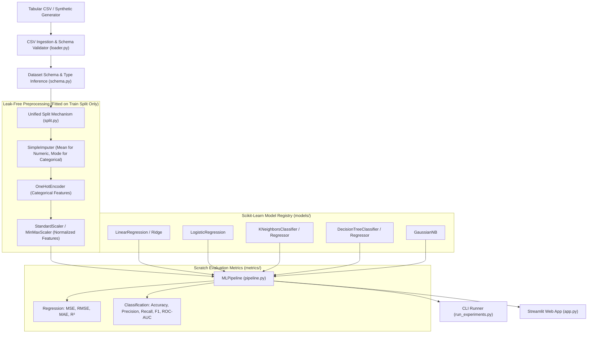

# EduPredict: Classical Machine Learning Framework

[](https://www.python.org/downloads/)
[]()
[]()

> **EduPredict** is an educational Classical Machine Learning framework designed for predicting student academic performance (continuous score regression) and early academic risk detection (binary classification). 
> 
> The core architectural principle of EduPredict is a rigorous division of responsibilities: **all mathematical operations, linear algebra routines, descriptive statistics, missing value imputation, categorical encoding, feature scaling, analytical loss functions, optimization algorithms, data splitting, and evaluation metrics are implemented entirely from first principles using standard Python**. For model training and prediction, standard **Scikit-learn estimators** are integrated into our custom, leak-free pipeline.

---

## Table of Contents
1. [Project Overview & Architectural Design](#1-project-overview--architectural-design)
2. [Strict Dependency & Boundary Policy](#2-strict-dependency--boundary-policy)
3. [System Architecture](#3-system-architecture)
4. [Dataset & Problem Formulation](#4-dataset--problem-formulation)
5. [Mathematical Foundations & Linear Algebra Implemented From Scratch](#5-mathematical-foundations--linear-algebra-implemented-from-scratch)
6. [Data Preprocessing & Data Leakage Prevention](#6-data-preprocessing--data-leakage-prevention)
7. [Objective Functions, Loss Gradients & Optimization](#7-objective-functions-loss-gradients--optimization)
8. [Machine Learning Models & Scikit-Learn Integration](#8-machine-learning-models--scikit-learn-integration)
9. [Evaluation Metrics Implemented From Scratch](#9-evaluation-metrics-implemented-from-scratch)
10. [Unified MLPipeline & Experiment Suite](#10-unified-mlpipeline--experiment-suite)
11. [Interactive Streamlit Web Dashboard](#11-interactive-streamlit-web-dashboard)
12. [Empirical Benchmark Results](#12-empirical-benchmark-results)
13. [Setup & Execution Instructions](#13-setup--execution-instructions)
14. [Testing & Verification](#14-testing--verification)

---

## 1. Project Overview & Architectural Design

In modern machine learning education, practitioners often treat pipelines as black boxes, calling high-level libraries without grasping numerical stability, gradient derivations, matrix conditioning, data leakage traps, or decision boundary geometry.

EduPredict addresses this by demystifying classical machine learning:
- **Two Educational Objectives:**
  1. **Academic Performance Regression:** Predict continuous student final examination scores ($\hat{y} \in [0.0, 100.0]$) given study hours, prior exam scores, class attendance, and assignment completion.
  2. **Academic Risk Early Warning:** Classify students into **Normal / Good Standing ($0$)** vs. **At-Risk ($1$)** ($< 60.0\%$ threshold) to enable timely academic mentoring and targeted interventions.
- **Generic Tabular Capabilities:** While pre-configured for student analytics, the framework dynamically infers schemas, detects numerical and categorical features, handles missing values, and trains models on any tabular dataset.

---

## 2. Strict Dependency & Boundary Policy

EduPredict enforces a strict architectural boundary verified by automated Abstract Syntax Tree (AST) scanning (`tests/test_dependency_compliance.py`):

| Component Area | Allowed Tooling | Prohibited Libraries |
| :--- | :--- | :--- |
| **Linear Algebra & Vector Math** | **Pure Python Standard Library** (`math`) | NumPy, SciPy |
| **Descriptive Statistics** | **Pure Python Standard Library** | NumPy, SciPy, Pandas, Statsmodels |
| **Data Ingestion & Parsing** | **Pure Python Standard Library** (`csv`) | Pandas |
| **Preprocessing & Transformers** | **Custom From Scratch** (`SimpleImputer`, `OneHotEncoder`, `StandardScaler`) | Scikit-learn preprocessing |
| **Data Splitting & CV** | **Custom From Scratch** (`train_test_split`, `KFold`, `StratifiedKFold`) | Scikit-learn model_selection |
| **Loss Functions & Gradients** | **Custom From Scratch** (MSE, MAE, BCE, analytical gradients) | PyTorch, TensorFlow, SciPy |
| **Optimization** | **Custom From Scratch** (Gradient Descent, Momentum, Early Stopping) | Scikit-learn optimizers, PyTorch |
| **Evaluation Metrics** | **Custom From Scratch** (Accuracy, Precision, Recall, F1, Confusion Matrix, ROC-AUC, MSE, RMSE, MAE, R²) | Scikit-learn metrics |
| **Predictive Estimators** | **Scikit-learn** (`LinearRegression`, `Ridge`, `LogisticRegression`, `KNeighborsClassifier`, `KNeighborsRegressor`, `DecisionTreeClassifier`, `DecisionTreeRegressor`, `GaussianNB`) | Custom reimplementations |
| **Presentation & UI** | **Streamlit & Matplotlib** | Seaborn, Plotly |

---

## 3. System Architecture



---

## 4. Dataset & Problem Formulation

### 4.1 Provenance Notice
The benchmark dataset (`data/student_performance.csv`) is a **reproducible synthetic dataset** modeled after classical student achievement benchmarks (Cortez & Silva, 2008). It was generated with realistic non-linear relationships, socio-environmental interactions, and ~2% injected missingness for offline evaluation.

### 4.2 Feature Dictionary
| Feature Name | Type | Value Range | Description |
| :--- | :--- | :--- | :--- |
| `student_id` | Identifier | `STU_0001` - `STU_0600` | Unique student record key (auto-detected as ignored). |
| `study_hours` | Numerical (Float) | $4.0 - 40.0$ hrs/wk | Average dedicated weekly self-study hours. |
| `attendance` | Numerical (Float) | $45.0\% - 100.0\%$ | Class attendance percentage across the term. |
| `past_score` | Numerical (Float) | $30.0 - 95.0$ marks | Performance score in prerequisite / midterm exams. |
| `assignments_completed` | Numerical (Integer) | $0 - 10$ | Count of completed and submitted laboratory exercises. |
| `parental_education` | Categorical | `HighSchool`, `Bachelor`, `Master` | Highest educational level of parents/guardians. |
| `internet_access` | Categorical | `Yes`, `No` | High-speed internet access at residence. |
| `tutoring` | Categorical | `Yes`, `No` | Enrollment in supplemental academic tutoring. |
| **`final_exam_score`** | **Target (Regression)** | **$0.0 - 100.0$** | Continuous cumulative final examination score. |
| **`academic_risk`** | **Target (Classification)** | **`0` or `1`** | `1` if `final_exam_score < 60.0`, else `0`. |

---

## 5. Mathematical Foundations & Linear Algebra Implemented From Scratch

All fundamental numerical routines are implemented in `edupredict/math/` without third-party dependencies:

### 5.1 Vector Calculus (`vectors.py`)
- **Dot Product:**
  $$\mathbf{u} \cdot \mathbf{v} = \sum_{i=1}^n u_i v_i$$
- **Euclidean ($L_2$) Distance:**
  $$d_2(\mathbf{u}, \mathbf{v}) = \sqrt{\sum_{i=1}^n (u_i - v_i)^2}$$
- **Manhattan ($L_1$) Distance:**
  $$d_1(\mathbf{u}, \mathbf{v}) = \sum_{i=1}^n |u_i - v_i|$$

### 5.2 Matrix Operations & Inversion (`matrices.py`)
- **Matrix Multiplication:**
  $$(\mathbf{A}\mathbf{B})_{ij} = \sum_{k=1}^p A_{ik} B_{kj}$$
- **Matrix Inversion via Gauss-Jordan Elimination with Partial Pivoting:**
  To solve $(\mathbf{X}^T\mathbf{X})^{-1}$ without external BLAS routines, we construct the augmented matrix $[\mathbf{A} \mid \mathbf{I}]$:
  1. **Row Pivoting:** Find $\max_{k \ge i} |A_{ki}|$ and swap rows to maximize the pivot element, mitigating floating-point instability.
  2. **Row Scaling:** Normalize the pivot row so that $A_{ii} = 1.0$.
  3. **Row Elimination:** For all $k \neq i$, subtract $A_{ki} \times \text{Row}_i$ to eliminate non-diagonal elements.
  4. Returns the inverted matrix with singular matrix exception handling.

### 5.3 Descriptive Statistics (`stats.py`)
- **Sample Variance & Standard Deviation:**
  $$s^2 = \frac{1}{n-1} \sum_{i=1}^n (x_i - \bar{x})^2, \quad s = \sqrt{s^2}$$
- **Pearson Product-Moment Correlation:**
  $$r_{xy} = \frac{\sum_{i=1}^n (x_i - \bar{x})(y_i - \bar{y})}{\sqrt{\sum (x_i - \bar{x})^2} \sqrt{\sum (y_i - \bar{y})^2}}$$

### 5.4 Activations & Numerical Stability (`activations.py`)
- **Numerically Stable Sigmoid:**
  $$\sigma(z) = \begin{cases} \frac{1}{1 + e^{-z}} & \text{if } z \ge 0 \\ \frac{e^z}{1 + e^z} & \text{if } z < 0 \end{cases}$$
  Preventing 64-bit IEEE 754 floating-point overflow for large negative exponents.
- **Safe Logarithm:**
  $$\text{safe\_log}(p) = \ln(\max(\min(p, 1 - 10^{-15}), 10^{-15}))$$

---

## 6. Data Preprocessing & Data Leakage Prevention

Data leakage occurs when test data statistics inadvertently contaminate the training process. EduPredict strictly enforces isolation:

```
[Raw Records]
     │
     ▼
[train_test_split] ──► Preserves exact sample indices across features & targets
     │
     ├──► Train Split (X_train, y_train)
     │         │
     │         ├──► Fit SimpleImputer(mean / mode)
     │         ├──► Fit OneHotEncoder(drop_first=False)
     │         └──► Fit StandardScaler(mean, std)
     │
     └──► Test Split (X_test, y_test)
               │
               └──► TRANSFORM ONLY using frozen training statistics!
```

### Preprocessors Implemented From Scratch (`edupredict/preprocessing/`):
1. **`SimpleImputer`:**
   - Numerical: Imputes missing entries using training feature mean or median.
   - Categorical: Imputes missing entries using training feature mode.
2. **`OneHotEncoder`:**
   - Learns unique category vocabularies from training data only.
   - Handles unseen categories in test or inference data safely by assigning all-zero indicator vectors.
3. **`StandardScaler`:**
   - Standardizes features to zero mean and unit variance ($z = \frac{x - \mu}{\sigma}$).
   - Handles constant features ($\sigma = 0$) by setting scaled values to $0.0$.

---

## 7. Objective Functions, Loss Gradients & Optimization

Available as mathematical and educational implementations in `edupredict/losses/` and `edupredict/optimization/`:

### 7.1 Analytical Loss Functions
- **Mean Squared Error (MSE):**
  $$J(\mathbf{w}, b) = \frac{1}{m} \sum_{i=1}^m (\hat{y}_i - y_i)^2, \quad \nabla_{\mathbf{w}} J = \frac{2}{m} \mathbf{X}^T (\hat{\mathbf{y}} - \mathbf{y})$$
- **Binary Cross-Entropy (Log Loss):**
  $$J(\mathbf{w}, b) = -\frac{1}{m} \sum_{i=1}^m \left[ y_i \ln(p_i) + (1 - y_i) \ln(1 - p_i) \right], \quad \nabla_{\mathbf{w}} J = \frac{1}{m} \mathbf{X}^T (\mathbf{p} - \mathbf{y})$$

### 7.2 Gradient Descent Optimization Engine (`gradient_descent.py`)
- Configurable **Batch**, **Mini-Batch**, and **Stochastic Gradient Descent (SGD)**.
- **Polyak Momentum Update:**
  $$\mathbf{v}_t = \beta \mathbf{v}_{t-1} + \nabla J(\mathbf{w}_t), \quad \mathbf{w}_{t+1} = \mathbf{w}_t - \alpha \mathbf{v}_t$$
- **Early Stopping & Tolerance Checks:** Monitors loss delta across consecutive epochs with configurable patience.

---

## 8. Machine Learning Models & Scikit-Learn Integration

EduPredict interfaces standard Scikit-learn estimators through a centralized registry (`edupredict/models/registry.py`):

### Supported Regression Estimators:
- `Linear Regression` (`sklearn.linear_model.LinearRegression`)
- `Ridge Regression` (`sklearn.linear_model.Ridge`)
- `KNN Regressor` (`sklearn.neighbors.KNeighborsRegressor`)
- `Decision Tree Regressor` (`sklearn.tree.DecisionTreeRegressor`)

### Supported Classification Estimators:
- `Logistic Regression` (`sklearn.linear_model.LogisticRegression`)
- `KNN Classifier` (`sklearn.neighbors.KNeighborsClassifier`)
- `Decision Tree Classifier` (`sklearn.tree.DecisionTreeClassifier`)
- `Gaussian Naive Bayes` (`sklearn.naive_bayes.GaussianNB`)

Models are instantiated dynamically with validated hyperparameters based on the chosen task.

---

## 9. Evaluation Metrics Implemented From Scratch

All performance metrics in EduPredict are calculated using our own formulations (`edupredict/metrics/`):

### 9.1 Regression Metrics
- **Mean Squared Error (MSE):** $\text{MSE} = \frac{1}{m} \sum_{i=1}^m (\hat{y}_i - y_i)^2$
- **Root Mean Squared Error (RMSE):** $\text{RMSE} = \sqrt{\text{MSE}}$
- **Mean Absolute Error (MAE):** $\text{MAE} = \frac{1}{m} \sum_{i=1}^m |\hat{y}_i - y_i|$
- **Coefficient of Determination ($R^2$):**
  $$R^2 = 1 - \frac{\sum_{i=1}^m (\hat{y}_i - y_i)^2}{\sum_{i=1}^m (y_i - \bar{y})^2}$$
  Guarded against division-by-zero for constant target sequences.

### 9.2 Classification Metrics
- **Confusion Matrix:** Counts True Positives (TP), False Positives (FP), True Negatives (TN), and False Negatives (FN).
- **Accuracy:** $\frac{\text{TP} + \text{TN}}{\text{TP} + \text{TN} + \text{FP} + \text{FN}}$
- **Precision:** $\frac{\text{TP}}{\text{TP} + \text{FP}}$ (with configurable `zero_division` fallback)
- **Recall:** $\frac{\text{TP}}{\text{TP} + \text{FN}}$
- **$F_1$-Score:** $2 \cdot \frac{\text{Precision} \cdot \text{Recall}}{\text{Precision} + \text{Recall}}$
- **ROC Curves & Numerical AUC Integration:**
  Generates decision thresholds from unique predicted probabilities, computes $(\text{FPR}, \text{TPR})$ coordinates, and integrates the Area Under the Curve using the **trapezoidal rule**:
  $$\text{AUC} = \sum_{k=1}^K \frac{\text{TPR}_k + \text{TPR}_{k-1}}{2} \times (\text{FPR}_k - \text{FPR}_{k-1})$$

---

## 10. Unified MLPipeline & Experiment Suite

Both the CLI runner and Streamlit dashboard invoke a single, canonical pipeline:

```python
from edupredict.data.schema import infer_schema
from edupredict.pipeline.pipeline import MLPipeline, ExperimentSuite

# 1. Infer schema
schema = infer_schema(headers, rows, target_column="final_exam_score", task_type="regression")

# 2. Initialize leak-free pipeline
pipe = MLPipeline(schema=schema, model_name="Linear Regression", random_seed=42)

# 3. Fit pipeline (splits data, fits transformers strictly on train, fits model)
pipe.fit(raw_X, y, test_size=0.2)

# 4. Access genuine test metrics computed from scratch
print(pipe.test_metrics)

# 5. Predict on unseen raw input records
prediction = pipe.predict_single({"study_hours": 25.0, "attendance": 85.0, ...})
```

---

## 11. Interactive Streamlit Web Dashboard

Launch the interactive interface:

```bash
streamlit run app.py
```

### Dashboard Tabs:
1. **📊 Dataset Overview & Validation:** Displays dataset shape, tabular preview, missing value counts, schema integrity report, and scratch-calculated correlation heatmaps.
2. **📈 Regression Studio:** Train Linear Regression, Ridge, KNN Regressor, or Decision Tree Regressor. Tune hyperparameters, inspect live R²/MSE/RMSE/MAE metrics, view actual-vs-predicted plots, and test single-student continuous score predictions dynamically.
3. **🎯 Classification Studio:** Train Logistic Regression, KNN, Decision Trees, or Gaussian Naive Bayes. Configure hyperparameters, inspect Accuracy/Precision/Recall/F1/ROC-AUC metrics, view confusion matrices, and evaluate risk probability on single students.
4. **📋 Empirical Benchmark Suite:** Executes all candidate models in real time and presents comprehensive comparison tables and diagnostic visualizations.
5. **📖 Architecture & Methods:** In-depth documentation of mathematical formulations, leakage prevention, and design decisions.

---

## 12. Empirical Benchmark Results

Evaluated on the 600-student benchmark cohort (80/20 train/test split, random seed = 42):

### 1. Final Exam Score Prediction (Regression)
| Model | MSE | RMSE | MAE | $R^2$ | Train Time | Infer Time |
| :--- | :---: | :---: | :---: | :---: | :---: | :---: |
| **Linear Regression** | **15.0098** | **3.8742** | **3.0986** | **0.8996** | 19.58 ms | 0.27 ms |
| **Ridge Regression** | 15.0487 | 3.8793 | 3.1041 | 0.8993 | 1.63 ms | 0.28 ms |
| **KNN Regressor ($k=5$)** | 47.1613 | 6.8674 | 5.4287 | 0.6845 | 1.70 ms | 1.97 ms |
| **Decision Tree Regressor**| 49.8733 | 7.0621 | 5.4953 | 0.6664 | 2.20 ms | 0.35 ms |

### 2. Early Academic Risk Detection (Classification)
| Model | Accuracy | Precision | Recall | $F_1$-Score | ROC-AUC | Train Time | Infer Time |
| :--- | :---: | :---: | :---: | :---: | :---: | :---: | :---: |
| **Logistic Regression** | **91.67%** | **0.9138** | **0.9138** | **0.9138** | **0.9672** | 5.62 ms | 0.42 ms |
| **Gaussian Naive Bayes** | 85.83% | 0.8596 | 0.8448 | 0.8522 | 0.9410 | 2.15 ms | 0.39 ms |
| **Decision Tree ($d=5$)**| 81.67% | 0.8913 | 0.7069 | 0.7885 | 0.8897 | 2.08 ms | 0.29 ms |
| **KNN Classifier ($k=5$)**| 81.67% | 0.8600 | 0.7414 | 0.7963 | 0.9066 | 1.77 ms | 2.53 ms |

*All reported metrics are computed directly by EduPredict's scratch metric functions on actual test predictions.*

---

## 13. Setup & Execution Instructions

### Prerequisites
- Python 3.10 or higher.

### Installation
Clone the repository and install the minimal presentation dependencies:

```bash
git clone https://github.com/Jenish045/EduPredict.git
cd EduPredict
pip install -r requirements.txt
```

### CLI Experiment Execution
Run the full benchmarking suite on the default student dataset:

```bash
python run_experiments.py --seed 42
```

Run on an arbitrary tabular dataset:

```bash
python run_experiments.py --data path/to/dataset.csv --target price --task regression
```

### Interactive Web Application
```bash
streamlit run app.py
```

---

## 14. Testing & Verification

Run the complete automated test suite (100 unit, integration, and compliance tests):

```bash
python -m unittest discover -s tests -v
```

### AST Dependency Compliance Scanner
Verify that prohibited libraries are never imported in custom scratch modules:

```bash
python -m unittest tests/test_dependency_compliance.py -v
```
